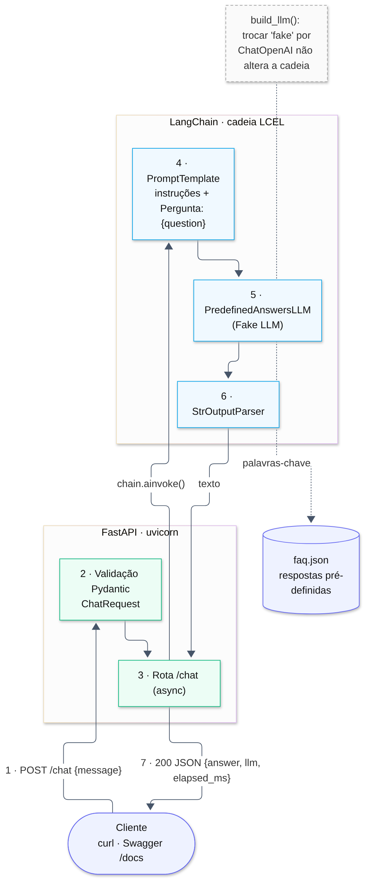
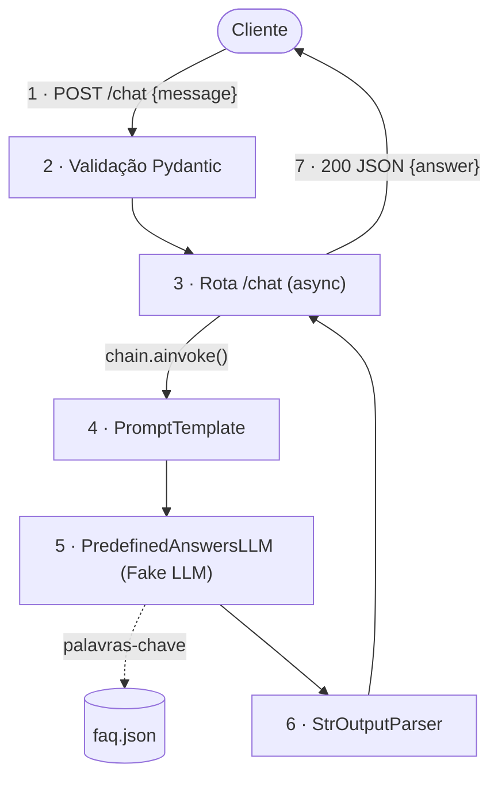

# Parte 2 · Questão 1 — Chatbot com LangChain + Fake LLM (FastAPI)

Protótipo de chatbot que recebe uma mensagem via **FastAPI**, passa por uma cadeia **LangChain**
(`PromptTemplate | LLM | StrOutputParser`) e devolve uma resposta **simulada por um Fake LLM** que
responde a perguntas pré-definidas (FAQ).

## Arquitetura



<details><summary>Código Mermaid do diagrama</summary>


</details>

**Fluxo de dados**

1. O cliente envia `POST /chat` com `{"message": "..."}`.
2. O **Pydantic** valida a entrada (não vazia, até 500 caracteres) → `422` se inválida.
3. A rota assíncrona chama `chain.ainvoke({"question": ...})`.
4. O **PromptTemplate** monta o prompt (instruções + `Pergunta: {question}`).
5. O **Fake LLM** (`PredefinedAnswersLLM`) lê a pergunta, normaliza (minúsculas, sem acentos) e
   escolhe a resposta da FAQ (`app/data/faq.json`) com mais palavras‑chave encontradas; sem
   correspondência, devolve uma resposta padrão.
6. O **StrOutputParser** converte a saída do modelo em `str`.
7. A API responde `{"message", "answer", "llm", "elapsed_ms"}`.

## Por que usar um Fake LLM?

| Benefício | Explicação |
|---|---|
| **Custo zero** | Nenhuma chamada paga a APIs durante o desenvolvimento e os testes. |
| **Velocidade** | Responde em ~1 ms (sem rede, sem GPU), então a suíte de testes roda em menos de 1 s. |
| **Determinismo** | A mesma pergunta sempre gera a mesma resposta, então os testes automatizados são estáveis (um LLM real varia). |
| **Isolamento** | Testa *a nossa* lógica (API, validação, prompt, cadeia, parser, erros) sem depender da disponibilidade, de limites de uso ou da latência do provedor. |
| **Funciona offline/CI** | Não precisa de chave de API nem de internet, o que é ideal para pipelines de CI. |
| **Troca transparente** | O Fake LLM herda de `langchain_core...LLM`; trocar por um modelo real muda **só** `build_llm()` (ver `APP_LLM_PROVIDER=openai`), e a cadeia e a API continuam iguais. |

Limitação: o Fake LLM **não** avalia a qualidade das respostas de um LLM real. Para isso são
necessários testes de integração/avaliação com o modelo de produção.

## Estrutura

```
app/
├── main.py        # FastAPI: lifespan, rotas /chat, /faq, /health
├── chain.py       # PromptTemplate | LLM | StrOutputParser + fábrica build_llm()
├── fake_llm.py    # PredefinedAnswersLLM (subclasse de LLM do LangChain)
├── schemas.py     # modelos Pydantic
├── config.py      # configurações (pydantic-settings, prefixo APP_)
└── data/faq.json  # perguntas/respostas pré-definidas (dados separados do código)
tests/             # testes do Fake LLM, da cadeia e da API (pytest)
```

## Como executar

Pré‑requisito: Python 3.10+.

```bash
python -m venv .venv
```

```bash
source .venv/bin/activate        # Windows: .venv\Scripts\activate
```

```bash
pip install -r requirements.txt
```

```bash
uvicorn app.main:app --reload
```

Documentação interativa (Swagger): http://127.0.0.1:8000/docs

### Exemplos

```bash
curl -X POST http://127.0.0.1:8000/chat -H "Content-Type: application/json" -d '{"message": "O que é FastAPI?"}'
```

Resposta real:

```json
{"message":"O que é FastAPI?","answer":"FastAPI é um framework web Python moderno, assíncrono e baseado em type hints, com validação via Pydantic e documentação automática (OpenAPI/Swagger).","llm":"predefined-answers-fake-llm","elapsed_ms":5.27}
```

Pergunta fora da FAQ → resposta padrão:

```json
{"message":"Qual a capital da Mongólia?","answer":"Desculpe, ainda não sei responder isso. Tente perguntar sobre horário, FastAPI, LangChain ou Fake LLM.","llm":"predefined-answers-fake-llm","elapsed_ms":1.46}
```

Outras rotas: `GET /faq` (perguntas suportadas) e `GET /health`.

### Testes

```bash
pytest -q
```

### Configuração (opcional)

| Variável | Padrão | Descrição |
|---|---|---|
| `APP_LLM_PROVIDER` | `fake` | `fake` ou `openai` (exige `pip install langchain-openai` e `OPENAI_API_KEY` exportada no ambiente) |
| `APP_OPENAI_MODEL` | `gpt-4o-mini` | Modelo usado se o provedor for `openai` |

## Referências

- LangChain: custom LLM — https://python.langchain.com/docs/how_to/custom_llm/
- FastAPI — https://fastapi.tiangolo.com/
- Uso de IA: desenvolvido com apoio do assistente Claude (Anthropic) como ferramenta de apoio; o código foi revisado, testado e é compreendido pelo autor.
